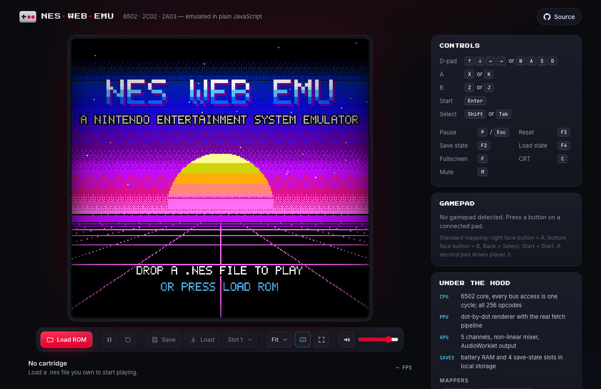
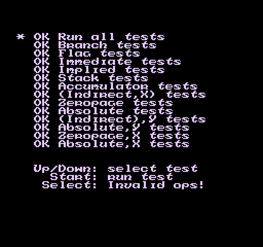

# NES Web Emu

*Bienvenue ! Un émulateur NES écrit en JavaScript moderne, qui tourne directement dans votre navigateur.*

A Nintendo Entertainment System emulator written in plain, modern JavaScript (ES modules, no build step, no dependencies). The CPU, PPU and APU are stepped together one CPU cycle at a time, which is enough to pass the classic CPU, PPU timing, APU and MMC3 test ROMs.

**Live demo: https://jimmykurc.github.io/nes-web-emu/**

[](https://github.com/jimmykurc/nes-web-emu/actions/workflows/test.yml)
[](LICENSE)



No games are included. Load a `.nes` file you are allowed to use (homebrew, or a dump of a cartridge you own) with the **Load ROM** button or by dropping it on the page. Everything runs locally; nothing is uploaded.

## Features

- **6502 CPU (2A03)**: all 151 official opcodes and all 105 unofficial ones (LAX, SAX, DCP, ISB, SLO, RLA, SRE, RRA, ANC, ALR, ARR, AXS, the SH* family, JAM...). Every bus access is one cycle, with the real dummy reads and writes, so page-crossing penalties, RMW double writes and DMA alignment come out right.
- **PPU (2C02)**: dot-by-dot rendering with the real background fetch pipeline and loopy `v/t/x/w` registers. Mid-frame scroll changes and split screens work, as do sprite 0 hit, 8x16 sprites, the buggy sprite overflow scan, left-column clipping, greyscale and colour emphasis, odd-frame dot skip, and the VBlank/NMI race conditions.
- **APU (2A03)**: two pulse channels with sweep, triangle, noise and DMC with sample DMA. Frame sequencer in 4- and 5-step modes with IRQ, non-linear mixer, and the console's high-pass/low-pass output filters. Output goes through an **AudioWorklet**, with dynamic rate control to keep latency low without crackles. There is a ScriptProcessor fallback for older browsers.
- **Mappers**: NROM, MMC1, UxROM, CNROM, MMC3 (with the A12 scanline IRQ) and AxROM. Together they cover a large part of the licensed NES library (see the table below).
- **Input**: keyboard, Gamepad API (two players) and an on-screen touch pad on phones and tablets.
- **Saves**: battery-backed RAM is saved to `localStorage` automatically, plus 4 save-state slots per game.
- **UI**: a dark, responsive single page with pause/reset, integer or fit-to-window scaling, a CRT filter (scanlines, aperture mask, vignette), fullscreen, volume and an FPS counter. Before a ROM is loaded, the screen shows an animated attract scene drawn at the NES's native 256x240 resolution.

### Controls

| NES | Keyboard | Gamepad (standard mapping) |
| --- | --- | --- |
| D-pad | Arrow keys or WASD | D-pad / left stick |
| A | X or K | Right face button |
| B | Z or J | Bottom face button |
| Start | Enter | Start |
| Select | Shift or Tab | Back / Select |

Hotkeys: `P`/`Esc` pause, `F3` reset, `F2` save state, `F4` load state, `F` fullscreen, `C` CRT filter, `M` mute.

## Mapper support

| # | Board | Status | Example games |
| --- | --- | --- | --- |
| 0 | NROM | Complete | Super Mario Bros., Donkey Kong, Excitebike |
| 1 | MMC1 (SxROM, incl. 512 KB SUROM) | Complete, with consecutive-write filtering | The Legend of Zelda, Metroid, Mega Man 2 |
| 2 | UxROM | Complete | Mega Man, Castlevania, Contra, DuckTales |
| 3 | CNROM | Complete, with bus conflicts | Arkanoid, Paperboy, Solomon's Key |
| 4 | MMC3 (TxROM) | Complete, A12-clocked scanline IRQ (Sharp behaviour) | Super Mario Bros. 3, Kirby's Adventure, Mega Man 3-6 |
| 7 | AxROM | Complete | Battletoads, Marble Madness, Wizards & Warriors |

Other mappers are reported with a clear error message.

## Architecture

```
index.html, css/            single static page
src/
  nes.js                    the console: CPU memory map, frame loop, save states
  cpu.js                    6502 core, table-driven, one cycle per bus access
  ppu.js                    2C02, one dot per step, sprite evaluation, palette
  apu.js                    2A03 audio channels, frame sequencer, mixer, filters
  controller.js             standard joypad shift register
  cartridge.js              iNES / NES 2.0 parser, CRC32
  mappers/                  mapper base class (8 KB / 1 KB bank windows) + boards
  state.js                  generic component (de)serialisation for save states
  palette.js                2C02 palette and colour-emphasis tables
  ui/                       browser front end: main loop, audio, input, idle screen
tests/                      node:test suites
```

**Timing model.** `CPU.read()` and `CPU.write()` each cost one cycle. Around every bus access the console runs two PPU dots, then the access, then the third PPU dot and one APU cycle. Interrupt lines are sampled at the end of each cycle, and the CPU acts on the value from the penultimate cycle of an instruction, as the real chip does. Because instructions are written as sequences of bus accesses (including the dummy ones), cycle counts are never looked up in a table. They follow from the access pattern, and the nestest log comparison checks every one of them.

**PPU.** Each call to `step()` emulates one dot: background tiles are fetched every 8 dots into 16-bit shift registers, `v` is incremented and reloaded at the same dots as on hardware, and sprites for the next line are evaluated at dot 257, then fetched during dots 257-320. The pattern-table addresses reach the mapper in the same order as on the real bus, which is what makes the MMC3 IRQ counter work without per-game hacks.

**Front end.** `requestAnimationFrame` drives a fixed 60.0988 Hz timestep, so high-refresh-rate monitors run at the right speed. The APU produces samples at the AudioContext's rate, and the worklet reports how full its buffer is. The emulator then adjusts its sample rate by up to ±0.5 % to keep about 50 ms of audio queued.

## Accuracy

These public test ROMs run headlessly in the test suite. All of them pass:

| Area | Test ROM | Result |
| --- | --- | --- |
| CPU | nestest (full 8991-line trace incl. unofficial opcodes, cycle counts compared) | pass |
| CPU | blargg `instr_test-v5` official_only and all_instrs (16/16) | pass |
| CPU | blargg `instr_timing`, `cpu_timing_test6`, `branch_timing` basics | pass |
| CPU | blargg `cpu_dummy_reads` | pass |
| PPU | blargg `ppu_vbl_nmi` (10/10: VBL set/clear time, NMI timing, suppression, odd-frame skip) | pass |
| PPU | blargg `sprite_hit_tests_2005` (11/11) | pass |
| APU | blargg `apu_test` (8/8: length counters, frame IRQ, DMC) | pass |
| Mapper | blargg `mmc3_test_2` 1-5 (clocking, details, A12, scanline timing, MMC3 IRQ) | pass |



### Known limitations

- NTSC only: there is no PAL or Dendy timing.
- Six mappers only. Boards such as MMC2/MMC4 (Punch-Out!!), MMC5, VRC2/4/6, FME-7 and Namco 163 are not implemented, and neither is Famicom expansion audio.
- Sprite evaluation happens all at once at dot 257 rather than cycle by cycle. `$2004` reads during rendering and the exact cycle the overflow flag is set are therefore approximate. PPU open-bus decay is not emulated.
- DMC sample fetches always stall the CPU for 4 cycles. The real stall is 1-4 cycles depending on alignment.
- Unstable unofficial opcodes (`XAA`, `LXA`, `SH*`, `TAS`) use common "typical chip" models.
- Colour emphasis is approximated by dimming the RGB channels, not by NTSC signal simulation.
- No Zapper, Power Pad or Four Score, and no rewind or netplay.
- Compatibility with commercial games has not been measured systematically here (the repository ships no ROMs). The supported boards are exercised by the test ROMs above.

## Running locally

The project is plain static files, so any web server works:

```sh
git clone https://github.com/jimmykurc/nes-web-emu.git
cd nes-web-emu
python3 -m http.server 8080
# open http://localhost:8080
```

ES modules and AudioWorklet need `http://` (not `file://`). On `localhost` you can also start a ROM from a URL on the same origin, for example `http://localhost:8080/?rom=roms/mygame.nes`.

## Tests

Requires Node.js 20+ (developed on Node 24). There is nothing to install.

```sh
npm run fetch-test-roms   # optional: downloads public test ROMs into test-roms/ (gitignored)
node --test               # or: npm test
```

Without the test ROMs, the CPU unit tests (instruction semantics, flags, cycle counts, dummy reads, interrupts), the mapper tests and the whole-system tests (frame timing, audio sample rate, controller, save-state determinism) still run, and the ROM-based suites are skipped. CI downloads the ROMs and runs everything on every push: 88 tests, all passing.

## Legal

This is an independent educational project and is not affiliated with Nintendo. "Nintendo Entertainment System" and "NES" are trademarks of Nintendo. The repository contains no Nintendo code and no copyrighted game ROMs. The test ROMs used by the test suite (by blargg, kevtris and others) are downloaded from their public mirror at test time and are not redistributed here. Only use ROM files you have the right to use.

## License

[MIT](LICENSE) © 2026 Jimmy Kurc
